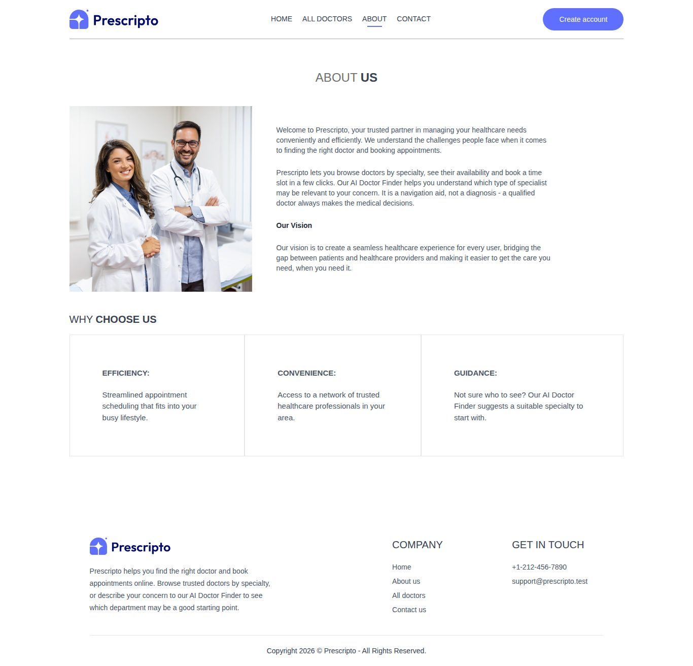
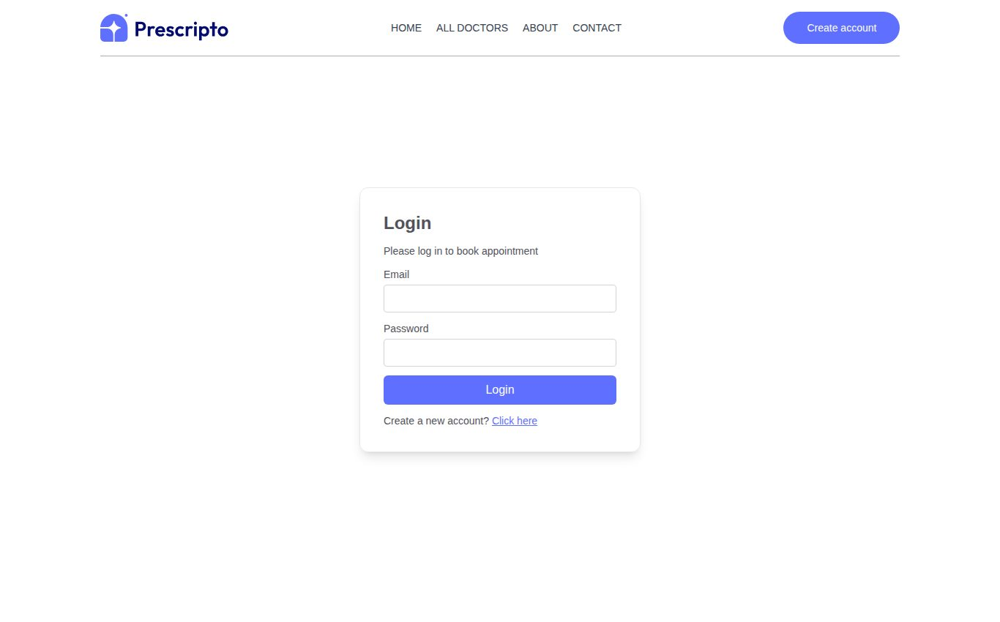
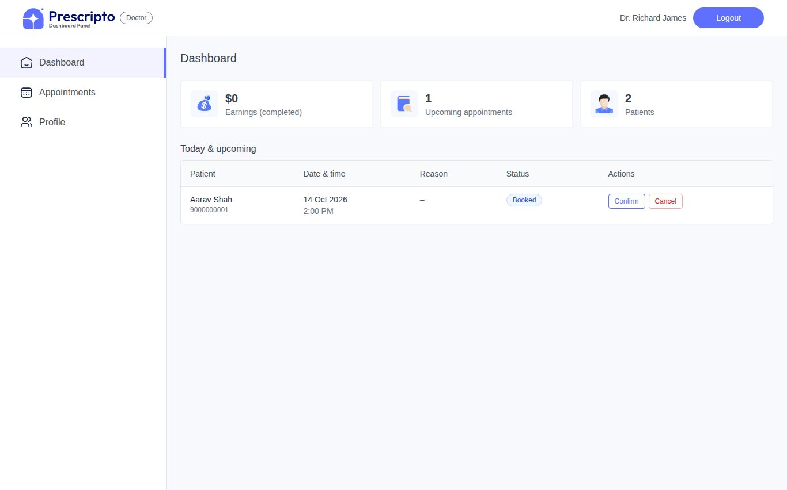
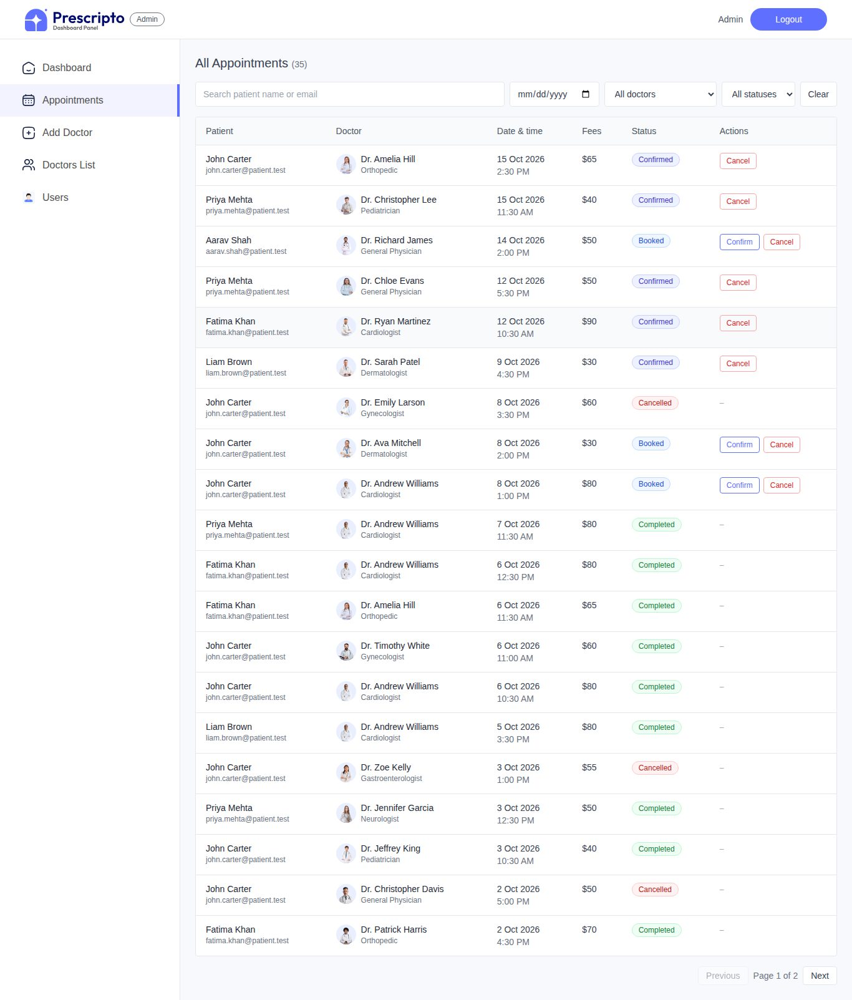

# Prescripto: Doctor Appointment Booking with an AI Doctor Finder

**Developed by Jiya Dodhiya** · GitHub: [@jiyaa2711](https://github.com/jiyaa2711)

Patients can browse doctors, book and cancel appointments, and describe their problem in their own words to an **AI Doctor/Department Finder**. The finder suggests which *type* of doctor to see and then shows real doctors from the database. Doctors manage their own appointments, and admins manage everything from an admin panel.

> The AI is a **navigation assistant, not a diagnosis tool.** It only picks a department from the app's own list, never names diseases or medicines, and always shows a disclaimer. Emergency-like messages get urgent-care advice.

| Part | Technology |
|---|---|
| Frontend | React 19, Vite, React Router, Tailwind CSS, axios, react-toastify, recharts |
| Backend | Node.js, Express 4, Mongoose (MongoDB) |
| Auth | JWT + bcrypt password hashing, role-based access (patient / doctor / admin) |
| AI | Google Gemini (`generateContent` REST API with a JSON response schema) |

---

## Screenshots

> Captured from the running app with the demo data created by `npm run seed -- --demo-appointments`.

| Home with AI Doctor Finder | All doctors |
|---|---|
|  |  |

| About | Contact |
|---|---|
|  |  |

| Login / Sign up | Book an appointment |
|---|---|
|  |  |

| My appointments (patient) | Doctor dashboard |
|---|---|
|  |  |

| Admin: doctors | Admin: appointments |
|---|---|
|  |  |

---

## 1. Run the project

**Requirements:** Node.js 20+ and MongoDB running on `localhost:27017`.

```bash
# 1. Backend
cd backend
npm install
cp .env.example .env          # then fill in the values (see section 2)
npm run seed -- --demo-appointments   # admin + 15 doctors (+ demo patients/appointments)
npm run dev                   # http://localhost:5000

# 2. Frontend (in a second terminal, from the project root)
npm install
cp .env.example .env          # VITE_BACKEND_URL=http://localhost:5000
npm run dev                   # http://localhost:5173
```

**Seed commands**

| Command | What it does |
|---|---|
| `npm run seed` | Adds the admin and doctors if they are missing. Never deletes anything. |
| `npm run seed -- --demo-appointments` | Also adds 5 demo patients and sample appointments, so the dashboard has data. |
| `npm run seed -- --reset --demo-appointments` | **Deletes all users, doctors and appointments** and starts fresh. |

**Demo logins.** The passwords are the ones you set in `backend/.env`.

| Role | Email | Password variable |
|---|---|---|
| Admin | `admin@prescripto.test` (`ADMIN_EMAIL`) | `ADMIN_PASSWORD` |
| Doctor | e.g. `richard.james@prescripto.test` (firstname.lastname@prescripto.test) | `SEED_DOCTOR_PASSWORD` |
| Patient | e.g. `aarav.shah@patient.test` (or sign up) | `SEED_PATIENT_PASSWORD` |

After login, admins go to `/admin`, doctors to `/doctor`, and patients to the website.

---

## 2. Environment variables

**`backend/.env`** holds the secrets. It is ignored by git and never sent to the browser.

| Variable | Required | Example / default | Purpose |
|---|---|---|---|
| `PORT` | no | `5000` | API port |
| `CLIENT_URL` | no | `http://localhost:5173` | Frontend origin allowed by CORS (comma-separated for several) |
| `MONGODB_URI` | no | `mongodb://localhost:27017/doctor_booking_db` | Database |
| `JWT_SECRET` | **yes** | 64+ random characters | Signs login tokens. The server refuses to start if it is missing or shorter than 32 characters. |
| `JWT_EXPIRES_IN` | no | `7d` | Login session length |
| `ADMIN_EMAIL`, `ADMIN_PASSWORD` | for seeding | | Admin account created by the seed script |
| `SEED_DOCTOR_PASSWORD`, `SEED_PATIENT_PASSWORD` | for seeding | | Passwords for the demo doctor and patient accounts |
| `AI_API_KEY` | for AI | | Google Gemini API key |
| `AI_MODEL` | no | `gemini-3.5-flash-lite` | Gemini model |
| `AI_TIMEOUT_MS` | no | `15000` | Give up on the AI after this many milliseconds |
| `AI_RATE_LIMIT_PER_MINUTE` | no | `10` | AI requests allowed per IP per minute |

To generate a JWT secret:

```bash
node -e "console.log(require('crypto').randomBytes(48).toString('hex'))"
```

**`.env` in the project root** is the frontend config. Only `VITE_BACKEND_URL` goes here. Anything in this file can end up in the browser, so **never put API keys here**.

### Configure the AI key
1. Create a key at <https://aistudio.google.com/apikey>.
2. Put it in **`backend/.env`**: `AI_API_KEY=your-key` (no quotes).
3. Restart the backend.

Without a key, the app still works fully. The AI box just says *"AI assistance is temporarily unavailable. You can browse doctors by specialty."*

---

## 3. How the AI Doctor Finder works

```
Patient types: "I have acne and skin irritation"
        │  POST /api/ai/doctor-finder
        ▼
Backend ─ 1. validate + clean the text (3–500 chars)
        ─ 2. emergency keyword check (chest pain, can't breathe, …), done by the server itself
        ─ 3. allowed list = specialties that have active doctors in MongoDB
        ─ 4. ask Gemini for JSON; "specialty" MUST be one of the allowed values
        ─ 5. re-check the answer (unknown specialty → General Physician,
             diagnosis/dosage wording in the reason → neutral text)
        ─ 6. Doctor.find({ specialty, isActive: true })   ← real doctors, never AI-generated
        ▼
Frontend shows: "Based on your description, you may want to consult a Dermatologist."
                + reason, confidence, urgent-care warning if needed, disclaimer
                + doctor cards with [View Doctor] [Book Appointment]
```

- **Book Appointment** opens the normal booking page (`/appointment/:id`). There is no separate AI booking system.
- **Where the code lives:**
  - `backend/services/aiService.js` is the only file that talks to Gemini.
  - `backend/services/doctorFinderService.js` holds the prompt, the emergency keywords, the answer checks and the disclaimer.
  - `backend/controllers/aiController.js` contains the endpoint.
  - `src/components/DoctorFinder.jsx` is the UI.
- **Admin AI Insights.** The admin dashboard can ask the AI to summarise **aggregated, anonymous** numbers (counts per status and specialty, and the 14-day trend). No patient names or contact details are sent.

---

## 4. Security
- Passwords are hashed with bcrypt and never returned by any API.
- The JWT holds only the user id. The **role is loaded from the database** on every request, so the frontend can't grant itself admin rights.
- Deactivated accounts are blocked immediately, even with an old token.
- Every protected route uses `protect` + `authorize(role)`. The frontend route guards are only for convenience.
- **Ownership checks:** patients only see and cancel their own appointments, and doctors only see and update theirs. Other users get `404`.
- **Input validation:**
  - MongoDB ids are validated.
  - Only allowed fields are copied from request bodies, so nobody can set their own `role` or `isActive`.
  - Keys starting with `$` are stripped (`express-mongo-sanitize`) to block NoSQL injection.
  - Search text is escaped before being used in a query.
- **Double booking** is blocked by a unique MongoDB index on doctor + date + time for active appointments, which works even for simultaneous requests.
- **Rate limits:** AI endpoints allow 10 requests per minute per IP. Login and register allow 10 *failed* attempts per 15 minutes.
- **Headers and limits:** `helmet` security headers, CORS limited to `CLIENT_URL`, 100 KB JSON body limit, and image uploads limited to JPG/PNG/WEBP up to 2 MB with random file names.
- **Errors:** one central error handler. Clients get clean messages, never stack traces. AI failures are logged without the patient's text.
- **The AI key stays on the server.** It is sent to Google only in a request header.

---

## 5. Tests

```bash
cd backend
npm test             # 133 API checks: auth, doctors, appointments, admin, AI (mock + "AI down")
npm test -- --live   # + 11 checks against the real Gemini API (uses a little quota)
```

The test runner seeds and uses a **separate database (`doctor_booking_test`)**, starts its own servers on ports 5100–5102 and a mock Gemini server on 5199, and **never touches your real data**. The mock Gemini lets the tests simulate AI timeouts, errors, made-up specialties and unsafe answers.

---

## 6. Project structure

```
backend/
  server.js                 app setup, security middleware, routes
  config/db.js              MongoDB connection
  constants/                specialties list, appointment statuses/rules
  models/                   User, Doctor, Appointment
  midle/                    auth (protect/authorize), errors, uploads, id validation
  controllers/              auth, user, doctor, appointment, admin, ai
  routes/                   auth, users, doctors, appointments, admin, ai
  services/                 aiService (Gemini), doctorFinderService, insightsService
  seed/                     seed script + demo data
  tests/                    automated API tests (npm test)
src/
  api/client.js             axios instance (adds the JWT, handles 401)
  context/AppContext.jsx    logged-in user, login/register/logout
  pages/                    Home, Doctors, Appointment (booking), MyAppointment, MyProfile, Login, About, Contact
  components/               Navbar, DoctorFinder (AI), DoctorCard, ... + shared panel components
  admin/                    Dashboard (+ AI Insights), Appointments, DoctorsList, DoctorForm, Users
  doctor/                   DoctorDashboard, DoctorAppointments, DoctorProfile
```

The full API reference is in [API_DOCS.md](API_DOCS.md).

---

Developed by **Jiya Dodhiya** (MCA student) · GitHub: [@jiyaa2711](https://github.com/jiyaa2711)
